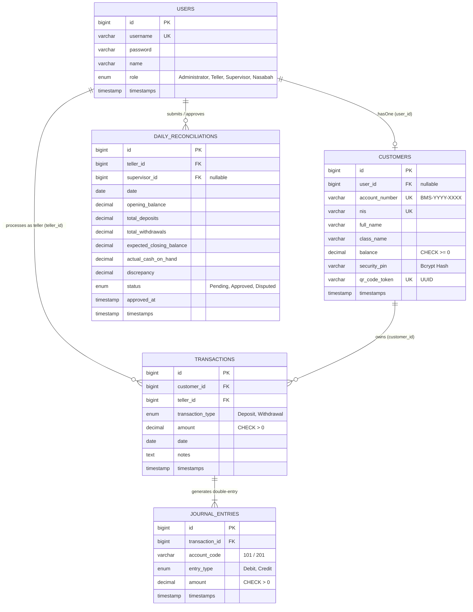

<div align="center">

# 🏦 Sistem Informasi E-Teller Bank Mini Sekolah
### Aplikasi Simulasi Operasional Perbankan & Rekonsiliasi Kas Harian Berbasis REST API

[](https://laravel.com)
[](https://php.net)
[-4479A1?style=for-the-badge&logo=mysql&logoColor=white)](https://mysql.com)
[](https://laravel.com/docs/sanctum)
[](LICENSE)

<br/>

**Proyek Uji Kompetensi Keahlian (UKK)**  
**Konsentrasi Keahlian:** Rekayasa Perangkat Lunak (RPL)  
**Institusi:** SMK Negeri 1 Bantul  
**Pengembang:** Arrasyd Nanda Fairuz ([@ZyuuDev](https://github.com/ZyuuDev))

---

</div>

## 📌 Tentang Proyek

**Sistem Informasi E-Teller Bank Mini Sekolah** adalah aplikasi manajemen transaksi perbankan mini sekolah yang dirancang untuk mensimulasikan alur kerja operasional loket perbankan nyata secara digital dan aman. 

Sistem ini mencakup seluruh siklus hidup perbankan mini mulai dari pendaftaran nasabah siswa (dilengkapi *auto-generated account number* & *QR Code identity*), transaksi setoran dan penarikan tunai loket berbasis verifikasi PIN 6-digit, pembukuan akuntansi otomatis berpasangan (*Double-Entry Bookkeeping*), hingga proses rekonsiliasi kas (*closing kasir*) harian dengan validasi bertingkat oleh Supervisor.

---

## ✨ Fitur Utama

### 🔐 1. Role-Based Access Control (RBAC) & Autentikasi Modern
Mendukung 4 level hak akses pengguna yang terisolasi secara ketat menggunakan **Laravel Sanctum Token-Based Authentication**:
- **👑 Administrator**: 
  - Manajemen data user internal (`CRUD`).
  - Pembuatan rekening nasabah dengan nomor rekening otomatis (`BMS-YYYY-XXXX`) dan token QR Code unik (`UUID`).
  - Audit trail seluruh jurnal akuntansi transaksi.
  - *Dibatasi: Tidak dapat melakukan input transaksi finansial.*
- **🏦 Teller (Petugas Loket)**:
  - Pencarian nasabah secara instan via **QR Code Scanner** atau nomor rekening.
  - Transaksi **Setoran Tunai** (*Cash Deposit*).
  - Transaksi **Penarikan Tunai** (*Cash Withdrawal*) dengan proteksi validasi saldo mengendap minimum dan otorisasi **PIN 6-digit nasabah** (Bcrypt).
  - Input rekonsiliasi kas harian (*cash on hand* vs *system calculation*).
  - Cetak draf laporan harian dan bukti transaksi/struk.
- **👔 Supervisor**:
  - Pemantauan seluruh laporan rekonsiliasi kas harian teller.
  - Verifikasi dan persetujuan (*Approval*) laporan rekonsiliasi.
  - Otorisasi pemindahan fisik kas harian ke brankas utama sekolah.
  - Audit jurnal akuntansi.
- **🧑‍🎓 Nasabah (Siswa)**:
  - Informasi rekening mandiri (cek saldo berjalan secara *real-time*).
  - Buku tabungan digital (riwayat mutasi kredit/debit lengkap).
  - Otorisasi PIN saat penarikan di loket teller.

---

### 💼 2. Keunggulan Arsitektur & Aturan Bisnis

1. **Jurnal Akuntansi Double-Entry (Sistem Pembukuan Berpasangan)**:
   Setiap transaksi finansial secara otomatis membukukan 2 baris jurnal (*Debit & Credit*) yang seimbang:
   - **Setoran**: Debet *Kas Loket (101)*, Kredit *Tabungan Nasabah (201)*.
   - **Penarikan**: Debet *Tabungan Nasabah (201)*, Kredit *Kas Loket (101)*.
2. **Database Transaction Integrity (`DB::transaction`)**:
   Semua operasi transaksi dibungkus dalam *database transaction* untuk mencegah inkonsistensi data / *race condition*.
3. **Validasi Saldo Mengendap & Proteksi Negatif**:
   Database dilengkapi *Check Constraint* (`balance >= 0`, `amount > 0`) serta validasi backend batas minimal saldo tabungan (Rp 10.000).
4. **Rekonsiliasi Kas Harian & Deteksi Selisih (Discrepancy)**:
   Sistem secara otomatis menghitung `Expected Balance = Saldo Awal + Total Setoran - Total Penarikan`. Jika terdapat selisih dengan fisik kas teller, sistem menandai status `Disputed` dan mengunci pencetakan laporan hingga diverifikasi Supervisor.
5. **Keamanan Data**:
   - PIN Keamanan & Password di-hash menggunakan algoritma `Bcrypt`.
   - Token QR Code berformat UUID v4 unik untuk setiap nasabah.
   - Restrict Foreign Key pada seluruh data relasional penting.

---

## 🏗️ Arsitektur & Skema Database

Sistem didesain dengan normalisasi **3rd Normal Form (3NF)** menggunakan *Storage Engine* **MySQL InnoDB**:



---

## 🌐 Daftar Endpoint REST API

Semua endpoint berbasis format JSON dan dilindungi *middleware role-based*.

### 🔑 Autentikasi (`/api/auth`)
| Method | Endpoint | Akses | Deskripsi |
|---|---|:---:|---|
| `POST` | `/api/auth/login` | Public | Login pengguna, menghasilkan Sanctum Bearer Token |
| `POST` | `/api/auth/logout` | Auth | Menghapus token aktif pengguna saat ini |
| `GET` | `/api/auth/me` | Auth | Mendapatkan profil pengguna yang sedang login |

---

### 👑 Administrator (`/api/admin`)
| Method | Endpoint | Role | Deskripsi |
|---|---|:---:|---|
| `GET` | `/api/admin/users` | Administrator | Menampilkan daftar seluruh akun user |
| `POST` | `/api/admin/users` | Administrator | Menambahkan user baru (*Admin, Teller, Supervisor, Nasabah*) |
| `GET` | `/api/admin/users/{id}` | Administrator | Melihat detail data user |
| `PUT` | `/api/admin/users/{id}` | Administrator | Memperbarui informasi user |
| `DELETE` | `/api/admin/users/{id}` | Administrator | Menghapus akun user |
| `GET` | `/api/admin/customers` | Administrator | Menampilkan daftar seluruh nasabah |
| `POST` | `/api/admin/customers` | Administrator | Mendaftarkan nasabah & rekening baru (Auto Generate No. Rekening & QR) |
| `GET` | `/api/admin/customers/{id}` | Administrator | Melihat detail profil nasabah & saldo |
| `PUT` | `/api/admin/customers/{id}` | Administrator | Memperbarui data nasabah |

---

### 🏦 Teller (`/api/teller`)
| Method | Endpoint | Role | Deskripsi |
|---|---|:---:|---|
| `GET` | `/api/teller/search` | Teller | Mencari nasabah via query `account_number` atau `qr_token` |
| `POST` | `/api/teller/deposit` | Teller | Memproses setoran tunai & mencatat jurnal |
| `POST` | `/api/teller/withdraw` | Teller | Memproses penarikan tunai dengan verifikasi PIN nasabah |
| `POST` | `/api/teller/reconciliation` | Teller | Submit rekonsiliasi kas harian teller |
| `GET` | `/api/teller/report/{id}` | Teller | Melihat rincian draf laporan rekonsiliasi harian |

---

### 👔 Supervisor (`/api/supervisor`)
| Method | Endpoint | Role | Deskripsi |
|---|---|:---:|---|
| `GET` | `/api/supervisor/reconciliations` | Supervisor | Menampilkan daftar laporan rekonsiliasi kas (Pending/Disputed) |
| `POST` | `/api/supervisor/approve/{id}` | Supervisor | Menyetujui (*Approve*) rekonsiliasi kas harian teller |

---

### 🧑‍🎓 Nasabah (`/api/nasabah`)
| Method | Endpoint | Role | Deskripsi |
|---|---|:---:|---|
| `GET` | `/api/nasabah/balance` | Nasabah | Melihat saldo rekening tabungan pribadi |
| `GET` | `/api/nasabah/mutations` | Nasabah | Melihat riwayat transaksi (buku mutasi) pribadi |

---

## 💻 Tech Stack & Kebutuhan Sistem

- **Server Environment:** Laragon / XAMPP
- **Bahasa Pemrograman:** PHP >= 8.2 (Disarankan PHP 8.3 / 8.4)
- **Framework:** Laravel 11.x / 12.x
- **Database:** MySQL 8.0+ / MariaDB 10.4+
- **Manajemen Paket:** Composer & NPM
- **Library Tambahan:**
  - `laravel/sanctum` — Autentikasi API Token
  - `simplesoftwareio/simple-qrcode` — Pembangkit QR Code Nasabah

---

## 🚀 Panduan Instalasi Lokal

Ikuti langkah-langkah berikut untuk menjalankan proyek di komputer lokal:

### 1. Clone Repository
```bash
git clone https://github.com/ZyuuDev/UKK_E-Teller_Bank_Mini_ArrasydNandaFairuz.git
cd UKK_E-Teller_Bank_Mini_ArrasydNandaFairuz
```

### 2. Install Dependensi PHP & JavaScript
```bash
composer install
npm install
```

### 3. Konfigurasi Environment (`.env`)
Salin berkas `.env.example` menjadi `.env`:
```bash
cp .env.example .env
```
Sesuaikan konfigurasi database pada `.env`:
```env
DB_CONNECTION=mysql
DB_HOST=127.0.0.1
DB_PORT=3306
DB_DATABASE=bank_mini_db
DB_USERNAME=root
DB_PASSWORD=
```

### 4. Generate Application Key
```bash
php artisan key:generate
```

### 5. Migrasi & Seeding Database
Pastikan MySQL service aktif di Laragon/XAMPP, lalu jalankan:
```bash
php artisan migrate --seed
```

### 6. Jalankan Server Pengembangan
```bash
php artisan serve
```
Aplikasi backend API siap diakses pada: `http://127.0.0.1:8000`

---

## 👥 Akun Demo Bawaan (Default Seeders)

Setelah menjalankan `php artisan migrate --seed`, akun uji coba berikut siap digunakan:

| Role | Username | Password Default | Akses Menu |
|---|---|---|---|
| **Administrator** | `admin` | `password123` | Manajemen User & Rekening Nasabah |
| **Teller** | `teller01` | `password123` | Transaksi Loket & Closing Kasir |
| **Supervisor** | `supervisor` | `password123` | Verifikasi & Approval Rekonsiliasi |

---

## 📁 Struktur Direktori Proyek

```plaintext
UKK_E-Teller_Bank_Mini_ArrasydNandaFairuz/
├── app/
│   ├── Http/
│   │   ├── Controllers/
│   │   │   ├── Admin/         # UserController, CustomerController
│   │   │   ├── Teller/        # TransactionController, ReconciliationController
│   │   │   ├── Supervisor/    # ReconciliationController (Approve)
│   │   │   ├── Nasabah/       # AccountController (Balance & Mutasi)
│   │   │   └── AuthController.php
│   │   └── Middleware/        # RBAC Role Middleware
│   └── Models/                # User, Customer, Transaction, JournalEntry, DailyReconciliation
├── bootstrap/                 # Application Bootstrap & Configuration
├── config/                    # Application Configuration Files
├── database/
│   ├── migrations/            # Skema 5 Tabel 3NF & Constraints
│   └── seeders/               # DatabaseSeeder Akun Default
├── public/                    # Web Server Entry Point (index.php)
├── resources/                 # Views (Blade), CSS, dan JS
├── routes/
│   ├── api.php                # Definisi Endpoint REST API RBAC
│   └── web.php
├── tests/                     # Unit & Feature Tests
├── .env.example               # Template Konfigurasi Environment
├── composer.json              # Dependensi Paket PHP (Laravel & Sanctum)
├── package.json               # Dependensi Frontend / Vite
├── vite.config.js             # Konfigurasi Build Vite
└── README.md                  # Dokumentasi Utama Repositori
```

---

## 👨‍💻 Profil Pengembang

* **Nama Siswa:** Arrasyd Nanda Fairuz
* **Sekolah:** SMK Negeri 1 Bantul
* **Program Keahlian:** Rekayasa Perangkat Lunak (RPL)
* **GitHub:** [@ZyuuDev](https://github.com/ZyuuDev)

---

## 📄 Lisensi

Proyek ini dibuat untuk keperluan **Uji Kompetensi Keahlian (UKK) Rekayasa Perangkat Lunak SMKN 1 Bantul** dan didistribusikan di bawah lisensi open-source [MIT License](LICENSE).
