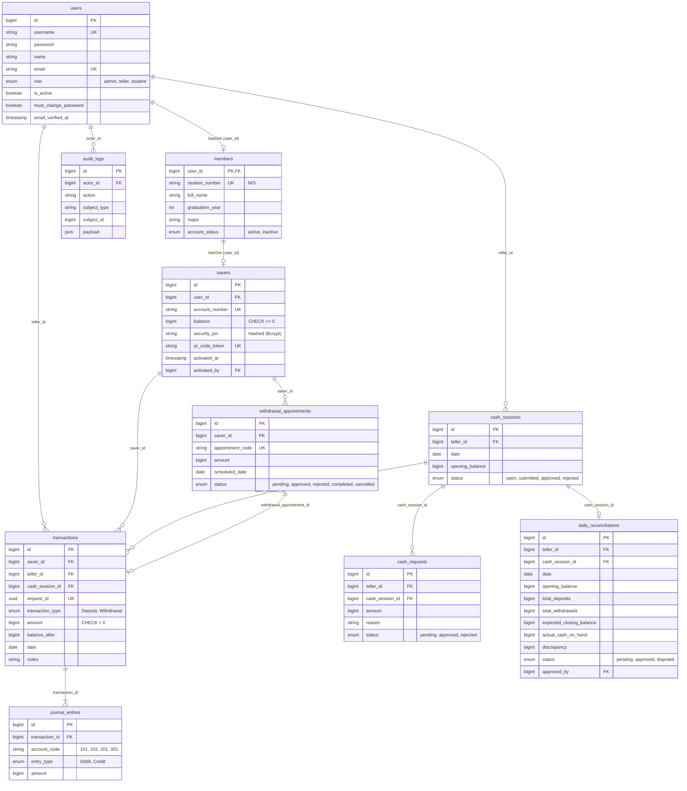

# Sistem Informasi E-Teller Bank Mini SMKN 1 Bantul
### Backend REST API & Web Portal Operasional Loket Bank Mini Sekolah

Dokumentasi teknis untuk proyek **Uji Kompetensi Keahlian (UKK)**  
**Konsentrasi Keahlian:** Rekayasa Perangkat Lunak (RPL)  
**Institusi:** SMK Negeri 1 Bantul  
**Pengembang:** Arrasyd Nanda Fairuz ([@ZyuuDev](https://github.com/ZyuuDev))

---

## 1. Deskripsi Proyek

**E-Teller Bank Mini SMKN 1 Bantul** adalah sistem informasi perbankan mini sekolah yang dirancang untuk mengelola operasional tabungan siswa, loket teller, pembukuan kas harian, dan rekonsiliasi kasir secara digital dan terstruktur.

Aplikasi pada direktori `dekstop/` ini mencakup dua komponen utama:
1. **Backend REST API**: Dibangun menggunakan **Laravel 11** untuk menangani seluruh logika bisnis perbankan, validasi saldo, otentikasi Sanctum, pembukuan berpasangan (*double-entry bookkeeping*), dan pencetakan laporan resmi berbasis PDF/CSV.
2. **Frontend Web Portal**: Dibangun menggunakan **React 19, Tailwind CSS, dan Vite** sebagai antarmuka loket interaktif bagi **Administrator** dan **Teller**.

---

## 2. Hak Akses & Pembagian Peran (RBAC)

Sistem membedakan hak akses secara ketat melalui middleware otentikasi token (Laravel Sanctum):

### A. Administrator (Pengelola & Supervisor)
* **Dasbor Keuangan**: Memantau total dana tabungan mengendap, mutasi harian, sesi kas teller yang aktif, grafik arus kas 7 hari, dan status operasional loket.
* **Manajemen Pengguna Petugas**: Menambah, mengedit, mengaktifkan/menonaktifkan akun admin dan teller, serta menerbitkan kata sandi sementara.
* **Manajemen Data Siswa (Anggota)**: Mendaftarkan siswa baru, memperbarui biodata (NIS, kelas, jurusan), mencetak kartu kredensial akun siswa, dan fitur **impor massal via berkas CSV**.
* **Rekening Penabung**: Memantau saldo total, saldo tersedia, dan saldo mengendap; mengaktifkan/memblokir akses rekening siswa; melakukan reset PIN ke default (123456); serta mencetak **Rekap Bulanan & Rekening Koran Nasabah** dalam format PDF dan CSV.
* **Rekonsiliasi & Tutup Kasir**: Memeriksa, menyetujui (*approve*), atau mengembalikan (*reject*) laporan rekonsiliasi kas harian teller, serta menangani sesi kas dengan selisih (*disputed*).
* **Persetujuan Kas Tambahan**: Memproses permohonan penambahan modal kas fisik dari loket teller.
* **Jurnal Umum & Audit Trail**: Memeriksa catatan jurnal akuntansi berpasangan dan riwayat aktivitas sistem (*audit log*).
* **Persetujuan Janji Temu**: Memeriksa dan memproses permohonan reservasi penarikan tabungan bernominal besar dari siswa.
* **Laporan Transaksi**: Melihat dan mengekspor rekap transaksi harian atau bulanan, lengkap dengan filter per teller maupun per nomor rekening nasabah.

### B. Teller (Petugas Loket Pelayanan)
* **Sesi Kas Harian (Cash Session)**: Wajib membuka kas awal loket sebelum melayani transaksi, memantau mutasi kas loket real-time, dan melakukan tutup kas di akhir hari kerja.
* **Pencarian Nasabah**: Menemukan data siswa melalui kamera pemindai **QR Code**, nomor rekening, atau NIS.
* **Aktivasi Rekening & Setoran Awal**: Membuka rekening baru siswa saat melakukan setoran pertama (minimal Rp 10.000) dan menentukan PIN 6-digit.
* **Transaksi Setoran Tunai**: Memproses setoran tabungan siswa tanpa potongan biaya.
* **Transaksi Penarikan Tunai**: Memproses penarikan tabungan dengan validasi otorisasi **PIN 6-digit nasabah** dan pengecekan saldo minimum mengendap (Rp 10.000).
* **Cetak Struk Resmi**: Mencetak bukti transaksi untuk setiap transaksi setoran maupun penarikan tunai.
* **Pengajuan Tambahan Kas**: Mengajukan permohonan pengisian kas loket ke Admin saat modal kas menipis.
* **Janji Temu Penarikan**: Memvalidasi siswa yang telah menjadwalkan penarikan tabungan terlebih dahulu.
* **Status Layanan Loket**: Mengubah status loket secara langsung (*Buka*, *Istirahat*, *Tutup*).

---

## 3. Aturan Bisnis & Logika Perbankan

1. **Pembukuan Berpasangan (*Double-Entry Bookkeeping*)**:
   Setiap transaksi finansial otomatis membukukan dua sisi jurnal yang seimbang:
   * **Setoran**: Debet *101 - Kas Tunai Loket*, Kredit *201 - Tabungan Nasabah Siswa*.
   * **Penarikan**: Debet *201 - Tabungan Nasabah Siswa*, Kredit *101 - Kas Tunai Loket*.
   * **Tambahan Kas Disetujui**: Debet *101 - Kas Tunai Loket*, Kredit *102 - Kas Brankas Utama*.
2. **Saldo Minimum Mengendap**:
   Setiap rekening penabung wajib mempertahankan saldo minimal sebesar **Rp 10.000**. Rumus saldo tersedia:
   $$\text{Saldo Tersedia} = \max(\text{Saldo Total} - \text{Rp 10.000}, 0)$$
   Penarikan yang menyebabkan saldo tersisa di bawah Rp 10.000 akan ditolak oleh sistem.
3. **Rekonsiliasi Kas Harian (*Discrepancy Check*)**:
   Saat teller melakukan tutup kas, sistem menghitung:
   $$\text{Kas Ekspektasi} = \text{Modal Awal} + \text{Total Setoran} - \text{Total Penarikan} + \text{Tambahan Kas Disetujui}$$
   Jika perhitungan fisik teller berbeda dengan catatan sistem, selisih (*discrepancy*) dicatat dan laporan berstatus `disputed` untuk diverifikasi manual oleh Admin.
4. **Penutupan Kas Otomatis Pukul 17:00 WIB**:
   Sesi kas teller yang belum ditutup hingga batas jam operasional (17:00 WIB) otomatis ditutup oleh sistem (*auto-close*) untuk mencegah manipulasi data transaksi susulan.
5. **Rekap Bulanan & Rekening Koran Nasabah**:
   Sistem dapat menghitung saldo awal bulan, akumulasi mutasi debet/kredit, dan saldo penutupan akhir bulan untuk setiap nasabah secara individual, serta mencetaknya ke format PDF resmi bertanda tangan dan stempel.

---

## 4. Struktur Database & Model Relasional

Sistem menggunakan database relasional **MySQL (InnoDB)** dengan normalisasi 3NF dan integritas *foreign key*:



---

## 5. Ringkasan Endpoint REST API

Semua rute API didefinisikan pada `routes/api.php` dengan awalan `/api`:

### Autentikasi & Akun (`/api/auth`)
* `POST /api/auth/login` — Autentikasi pengguna, menerbitkan token Sanctum.
* `POST /api/auth/logout` — Mencabut token yang sedang aktif.
* `GET /api/auth/me` — Mengambil data pengguna yang sedang login.
* `POST /api/auth/password` — Memperbarui kata sandi akun sendiri.
* `POST /api/auth/forgot-password` — Mengirim kode verifikasi reset password via email.
* `POST /api/auth/reset-password` — Mengganti password baru dengan token kode verifikasi.
* `POST /api/auth/forgot-pin` — Mengirim kode verifikasi reset PIN nasabah.
* `POST /api/auth/reset-pin` — Reset PIN nasabah menggunakan kode verifikasi email.

### Administrator (`/api/admin`) — Wajib Header `Authorization: Bearer <token>`
* `GET /api/admin/dashboard-stats` — Statistik ringkasan kas, grafik 7 hari, dan sesi kas teller.
* `GET /api/admin/users` — Daftar seluruh akun pengguna (admin & teller).
* `POST /api/admin/users` — Mendaftarkan petugas baru.
* `PATCH /api/admin/users/{user}` — Memperbarui informasi atau status aktif petugas.
* `POST /api/admin/users/{user}/credentials` — Menerbitkan password sementara petugas.
* `GET /api/admin/members` — Daftar data siswa/anggota dengan filter pencarian dan jurusan.
* `POST /api/admin/members` — Mendaftarkan data siswa baru.
* `PUT /api/admin/members/{member}` — Memperbarui data siswa.
* `DELETE /api/admin/members/{member}` — Menghapus data siswa yang belum memiliki rekening.
* `POST /api/admin/members/{member}/credentials` — Menerbitkan kredensial login awal siswa.
* `GET /api/admin/member-imports/template` — Mengunduh template berkas CSV data siswa.
* `POST /api/admin/member-imports` — Mengunggah berkas CSV siswa untuk dipratinjau (*preview*).
* `POST /api/admin/member-imports/{id}/commit` — Menyimpan data siswa hasil impor ke database.
* `GET /api/admin/savers` — Daftar seluruh rekening penabung dan saldonya.
* `POST /api/admin/savers/{id}/reset-pin` — Reset PIN rekening siswa ke default (123456).
* `GET /api/admin/savers/{saver}/statement` — Rekap mutasi bulanan nasabah (JSON).
* `GET /api/admin/savers/{saver}/statement/export` — Ekspor rekening koran bulanan nasabah (PDF / CSV).
* `PATCH /api/admin/student-access/{user}` — Mengaktifkan atau memblokir akses rekening siswa.
* `GET /api/admin/reconciliations` — Daftar laporan rekonsiliasi kas loket harian.
* `POST /api/admin/reconciliations/{report}/approve` — Menyetujui laporan rekonsiliasi kas loket.
* `POST /api/admin/reconciliations/{report}/reject` — Mengembalikan laporan kas loket yang bermasalah.
* `GET /api/admin/cash-requests` — Daftar permohonan tambahan kas loket teller.
* `POST /api/admin/cash-requests/{id}/approve` — Menyetujui permohonan tambahan kas loket.
* `POST /api/admin/cash-requests/{id}/reject` — Menolak permohonan tambahan kas loket.
* `GET /api/admin/journals` — Catatan jurnal umum akuntansi berpasangan (*double-entry*).
* `GET /api/admin/audit-logs` — Jejak rekam aktivitas (*audit trail*) sistem.
* `GET /api/admin/appointments` — Daftar pengajuan janji temu penarikan tabungan siswa.
* `POST /api/admin/appointments/{appointment}/approve` — Menyetujui janji temu penarikan siswa.
* `POST /api/admin/appointments/{appointment}/reject` — Menolak janji temu penarikan siswa.

### Teller (`/api/teller`) — Wajib Header `Authorization: Bearer <token>`
* `GET /api/teller/service-status` — Mengambil status operasional layanan loket.
* `POST /api/teller/service-status` — Memperbarui status layanan (*buka*, *istirahat*, *tutup*).
* `GET /api/teller/cash-sessions` — Riwayat sesi kas teller.
* `POST /api/teller/cash-sessions` — Membuka kas awal hari kerja teller.
* `POST /api/teller/cash-sessions/{session}/submit` — Mengirimkan laporan tutup kasir dan uang fisik.
* `GET /api/teller/cash-requests` — Daftar permohonan kas yang diajukan teller.
* `POST /api/teller/cash-requests` — Mengajukan permohonan tambahan modal kas loket.
* `GET /api/teller/search` — Mencari rekening nasabah via No. Rekening, NIS, atau QR Code token.
* `POST /api/teller/activate` — Aktivasi rekening pertama kali + setoran awal (minimal Rp 10.000).
* `POST /api/teller/deposit` — Transaksi setoran tunai tabungan.
* `POST /api/teller/withdraw` — Transaksi penarikan tunai tabungan (verifikasi PIN).
* `POST /api/teller/reset-pin` — Reset PIN nasabah oleh teller loket.
* `GET /api/teller/transactions/{transaction}` — Mengambil data struk bukti transaksi.
* `GET /api/teller/appointments` — Memeriksa daftar janji temu penarikan tabungan hari ini.

### Laporan Umum (`/api/reports`)
* `GET /api/reports/transactions` — Laporan transaksi harian/bulanan (filter teller & rekening).
* `GET /api/reports/export` — Mengunduh berkas laporan transaksi dalam format PDF atau CSV.

---

## 6. Panduan Menjalankan Sistem di Komputer Lokal

### Prasyarat Perangkat Lunak
* PHP >= 8.2 (Disarankan PHP 8.3 dengan ekstensi `pdo_mysql`, `mbstring`, `gd`, `openssl`).
* Composer 2.x.
* Node.js >= 18.x dan NPM.
* MySQL 8.0+ atau MariaDB 10.4+ (misal via Laragon atau XAMPP).

### Langkah Instalasi

1. **Pindah ke Direktori Proyek**:
   ```bash
   cd c:\laragon\www\UKK_E-Teller_Bank_Mini_ArrasydNandaFairuz\dekstop
   ```

2. **Pasang Dependensi Backend & Frontend**:
   ```bash
   composer install
   cd frontend
   npm install
   npm run build
   cd ..
   ```

3. **Konfigurasi Lingkungan (`.env`)**:
   Salin `.env.example` ke `.env` (jika belum ada) dan sesuaikan koneksi database MySQL:
   ```env
   APP_NAME="Bank Mini SMKN 1 Bantul"
   APP_ENV=local
   APP_KEY=base64:...
   APP_DEBUG=true
   APP_URL=http://127.0.0.1:8000

   DB_CONNECTION=mysql
   DB_HOST=127.0.0.1
   DB_PORT=3306
   DB_DATABASE=bank_mini_db
   DB_USERNAME=root
   DB_PASSWORD=
   ```

4. **Generate Application Key (jika baru)**:
   ```bash
   php artisan key:generate
   ```

5. **Migrasi Database & Seeder Bawaan**:
   Pastikan service MySQL aktif, buat database `bank_mini_db`, lalu jalankan:
   ```bash
   php artisan migrate --seed
   ```

6. **Sinkronisasi Symlink Berkas Storage**:
   ```bash
   php artisan storage:link
   ```

7. **Jalankan Server Lokal**:
   ```bash
   php artisan serve
   ```
   Aplikasi Web & Backend API siap diakses melalui peramban di: **`http://127.0.0.1:8000`**.

---

## 7. Akun Uji Coba Bawaan (Default Seeders)

| Peran | Username | Password | Keterangan |
|---|---|---|---|
| **Administrator** | `admin` | `password123` | Akses penuh dashboard, data siswa, rekening, dan rekonsiliasi |
| **Supervisor** | `supervisor` | `password123` | Akun pengawas operasional (level Administrator) |
| **Teller** | `teller01` | `password123` | Petugas loket transaksi setoran, penarikan, dan tutup kas |

> **Akun Siswa**: Dapat dibuat melalui menu **Data Anggota** di panel Admin atau diimpor massal menggunakan berkas template `TemplateSiswa.csv`.

---

## 8. Menjalankan Tes Otomatis (Feature Tests)

Proyek ini telah dilengkapi dengan 37 skenario pengujian otomatis berbasis PHPUnit untuk menguji keamanan RBAC, integritas kalkulasi saldo, rekonsiliasi kasir, auto-close sesi kas, dan ekspor rekening koran:

1. Buat database pengujian khusus di MySQL: `bank_mini_test`.
2. Jalankan perintah tes berikut dari PowerShell:
   ```powershell
   $env:DB_CONNECTION='mysql'
   $env:DB_DATABASE='bank_mini_test'
   $env:DB_USERNAME='root'
   $env:DB_PASSWORD=''
   .\vendor\bin\phpunit tests/Feature/
   ```
   *Seluruh 37 tes terverifikasi lulus 100% tanpa kegagalan.*

---

## 9. Profil Pengembang

* **Nama Siswa:** Arrasyd Nanda Fairuz
* **Institusi:** SMK Negeri 1 Bantul
* **Program Keahlian:** Rekayasa Perangkat Lunak (RPL)
* **Tahun Pembuatan:** 2026/2027
